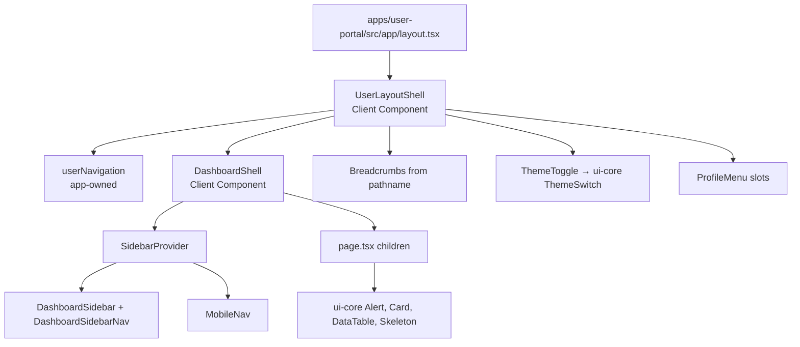

# Shared dashboard architecture

The dashboard applications share two packages with different responsibilities. `@template/ui-core` provides the design-system component foundation (Trello FE-UI-003; full API in [shared-components.md](../design-system/shared-components.md)): `cn`, a curated Lucide icon set, `Button`/`IconButton`, `Badge`, `Chip`, `Avatar`, `IconTile`, `Progress`, `Spinner`, `Divider`, `Card*`, `Panel`, `Stat`/`StatGrid`, `KeyValueList`, `ListRow`, native-first form controls (`Input`, `Select`, `Textarea`, `SearchInput`, `PasswordInput`, `OtpInput`, `Checkbox`, `RadioGroup`/`RadioCard`, `Switch`, `SegmentedControl`, `FormField`), Radix-based `Dialog`/`ConfirmDialog` and `Tabs`, `DataTable`, `Pager`, `Alert`, skeletons and `EmptyState`/`ErrorState`. Deprecated compatibility APIs (`buttonClassName`, `Modal`, `Pagination`, `StatusBadge`, `IconContainer`, `StatCard`, `SectionHeader`, `SettingsRow`) render through the new implementations until their consumers migrate. `Alert` centralizes success, error, warning, and informational presentation, optional dismissal, timed exit animation, and reduced-motion behaviour while leaving message state and copy in the consuming feature. `@template/dashboard-ui` provides the dashboard frame and navigation-oriented components: `DashboardShell`, sidebars, `DashboardBrand`, mobile controls, `ThemeToggle`, breadcrumbs, the page header (`DashboardHeader`), and profile menu, plus chart foundations at `@template/dashboard-ui/charts`. `dashboard-ui` depends on `ui-core` for icons and presentation primitives; the reverse dependency is not allowed. Both retain TailAdmin attribution.

Neither package owns User Portal or Admin Portal navigation. `userNavigation` and `adminNavigation` remain in their respective `apps/*/src/config/navigation.ts` files; the apps pass them to shared components as typed `DashboardNavItem[]`. That is what prevents a privileged admin destination from leaking into user navigation. Their focused Vitest tests check that distinction.

## Composition trace

Admin Portal follows the same shape through `AdminLayoutShell`, but supplies its own navigation, navigation icons, brand labels, breadcrumbs, and profile action slots. Each shell maps its app-owned navigation hrefs to `ui-core` icons, so `navigation.ts` stays plain data. The architecture deliberately shares the frame while keeping product-specific composition local.

## Sidebar state and responsive behaviour

`DashboardShell` installs `SidebarProvider`, then `DashboardFrame` reads its state through `useSidebar`. The provider stores two pieces of state:

- `isExpanded`: from the `lg` breakpoint the sidebar is 224px with icons and labels when true, and a 72px icon rail when false. `SidebarProvider` accepts `defaultExpanded` (default `true`).
- `isMobileOpen`: below `lg` the sidebar is an off-canvas drawer; DashboardShell renders a backdrop button that closes it, and choosing a navigation item closes it too.

`DashboardSidebar` reacts to that state for width, translation, and whether it renders the full `brand` or the compact `brandMark` (both usually `DashboardBrand`). `DashboardSidebarNav` renders supplied items with 44px rows and 20px icons; `isNavItemActive` marks an item active for its own path and nested paths (except `/`), sets `aria-current="page"`, and applies the brand-tinted selected style. In the collapsed rail each label becomes a tooltip shown on hover and keyboard focus, and remains the link's accessible name. The collapsed rail does not expand on hover. `MobileNav` renders the leading header controls: the drawer toggle below `lg`, the collapse toggle from `lg`, and the brand on narrow screens. `ThemeToggle` owns the local light/dark class: it reads `localStorage` or the system preference on mount, toggles `document.documentElement.classList`, and persists a `theme` value.

The header is a single 64px row: leading controls, breadcrumbs (hidden below `sm`), then the theme toggle and profile menu. `main` uses 16/24/32px horizontal padding by breakpoint, a 1600px maximum width, and no narrower page-level container, so settings pages use the available width.

These files use `"use client"` because React context/state, browser storage, media queries, and event handlers cannot execute in a Server Component. `Breadcrumbs`, `DashboardHeader`, `DashboardBrand`, and `ProfileMenu` themselves are reusable render components; their app-specific values are supplied by the shell.

## Page and settings conventions

- Start a dashboard page with `DashboardHeader`: an optional `icon` in a 48px brand-tinted tile, a 28px title, and a 14px description, directly on the page background rather than in a card. `eyebrow` remains available for pages that use it.
- Build new sections as `Card` with `CardHeader` (title, description, actions) and `CardContent`/`CardFooter`; put rows in `ListRow`, pairs in `KeyValueList`, state in a `Badge` whose text carries the meaning, and use `EmptyState`/`ErrorState`/skeletons for asynchronous states. Existing pages still use `SectionHeader`, `SettingsRow` and `StatusBadge`, which now render through the new components.
- Use `Button` (`primary`, `secondary`, `ghost`, `danger`, `dangerOutline`; `sm`; `loading`; `asChild` for links) or `buttonVariants` for button-styled elements. The legacy `buttonClassName` maps `destructive` → `dangerOutline`, `danger` → `danger` and `accent` → `secondary`. Use `ConfirmDialog` for destructive confirmations; existing `Modal` consumers keep their props on the accessible `Dialog` (focus trap and return, Escape, scroll lock).
- Feature-specific compositions stay in the app. The User Portal Security page (`apps/user-portal/src/app/security`) is the reference implementation.

## Theme and primitive boundary

Shared visual foundations live in `packages/ui-core/src/styles/theme.css`, exported as `@template/ui-core/theme.css` and imported by all three apps: a palette tier, semantic colour tokens swapped under `.dark` (`bg-surface`, `text-fg-muted`, `border-border`, `bg-brand`, `bg-success-bg`, chart and nav tokens), the type scale, recurring sizes, radius, elevation, layers, a global `:focus-visible` outline and reduced-motion rules. Dark mode is class-based: the `ui-core` `ThemeProvider` (`next-themes`, system default, storage key `theme`), composed in each app's `AppProviders`, sets `.dark`/`.light` on `<html>` before first paint. `ThemeToggle` renders the shared `ThemeSwitch`. Root layouts load Outfit and JetBrains Mono with `next/font/google` (self-hosted) as `--font-outfit-loaded` / `--font-jetbrains-mono-loaded`, which the theme maps to `--font-sans` / `--font-mono`.

`packages/dashboard-ui/src/tailadmin-theme.css` (exported as `@template/dashboard-ui/tailadmin-theme.css`) is now a temporary compatibility layer imported after the shared theme. It keeps the `brand-*` scale (pointing at the shared blue palette), the slate `gray-*` scale, `shadow-theme-*` and `no-scrollbar` that existing components still pair with `dark:` variants. New and migrated components use only semantic utilities; see [design foundations](../design-system/foundations.md). Application `globals.css` resets (`a { color: inherit }` and similar) live inside `@layer base` so Tailwind utilities can override them. Both dashboard application global stylesheets tell Tailwind to scan the shared source directories.

Use `ui-core` for domain-neutral controls and display primitives. Use `dashboard-ui` for a reusable dashboard layout or navigation presentation. Put application labels, routes, profile data, permissions, and API-backed behaviour in an app. The current page tables are empty-state examples, not connected account, authorization, audit, or health workflows.
