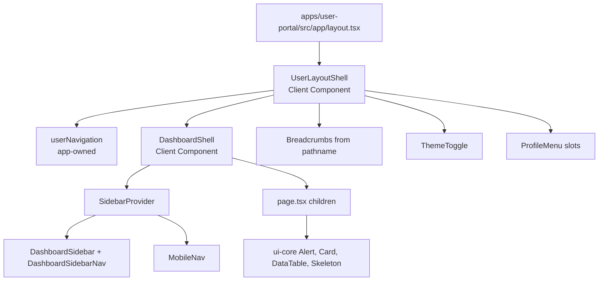

# Shared dashboard architecture

The dashboard applications share two packages with different responsibilities. `@template/ui-core` provides low-level, reusable dashboard primitives: alerts, cards, form controls, modal, pagination, skeleton, generic `DataTable`, accessible tabs, the outlined icon set (`icons.tsx`), `buttonClassName` variants, and the settings-page building blocks `SectionHeader`, `SettingsRow`, `StatusBadge`, `IconContainer`, and `EmptyState`. `Alert` centralizes success, error, warning, and informational presentation, optional dismissal, timed exit animation, and reduced-motion behaviour while leaving message state and copy in the consuming feature. `@template/dashboard-ui` provides the dashboard frame and navigation-oriented components: `DashboardShell`, sidebars, `DashboardBrand`, mobile controls, `ThemeToggle`, breadcrumbs, the page header (`DashboardHeader`), and profile menu. `dashboard-ui` depends on `ui-core` for icons and presentation primitives; the reverse dependency is not allowed. Both expose these APIs from `src/index.ts` and retain TailAdmin attribution.

Neither package owns User Portal or Admin Portal navigation. `userNavigation` and `adminNavigation` remain in their respective `apps/*/src/config/navigation.ts` files; the apps pass them to shared components as typed `DashboardNavItem[]`. That is what prevents a privileged admin destination from leaking into user navigation. Their focused Vitest tests check that distinction.

## Composition trace

Admin Portal follows the same shape through `AdminLayoutShell`, but supplies its own navigation, navigation icons, brand labels, breadcrumbs, and profile action slots. Each shell maps its app-owned navigation hrefs to `ui-core` icons, so `navigation.ts` stays plain data. The architecture deliberately shares the frame while keeping product-specific composition local.

## Sidebar state and responsive behaviour

`DashboardShell` installs `SidebarProvider`, then `DashboardFrame` reads its state through `useSidebar`. The provider stores two pieces of state:

- `isExpanded`: from the `lg` breakpoint the sidebar is 224px with icons and labels when true, and a 72px icon rail when false. `SidebarProvider` accepts `defaultExpanded` (default `true`).
- `isMobileOpen`: below `lg` the sidebar is an off-canvas drawer; DashboardShell renders a backdrop button that closes it, and choosing a navigation item closes it too.

`DashboardSidebar` reacts to that state for width, translation, and whether it renders the full `brand` or the compact `brandMark` (both usually `DashboardBrand`). `DashboardSidebarNav` renders supplied items with 44px rows and 20px icons; `isNavItemActive` marks an item active for its own path and nested paths (except `/`), sets `aria-current="page"`, and applies the brand-tinted selected style. In the collapsed rail each label becomes a tooltip shown on hover and keyboard focus, and remains the link's accessible name. The collapsed rail does not expand on hover. `MobileNav` renders the leading header controls: the drawer toggle below `lg`, the collapse toggle from `lg`, and the brand on narrow screens. `ThemeToggle` owns the local light/dark class: it reads `localStorage` or the system preference on mount, toggles `document.documentElement.classList`, and persists a `theme` value.

The header is a single 64px row: leading controls, breadcrumbs (hidden below `sm`), then the theme toggle and profile menu. `main` uses 16/24/32px horizontal padding by breakpoint, a 1600px maximum width, and no narrower page-level container, so settings pages use the available width.

These files use `"use client"` because React context/state, browser storage, media queries, and event handlers cannot execute in a Server Component. `Breadcrumbs`, `DashboardHeader`, `DashboardBrand`, and `ProfileMenu` themselves are reusable render components; their app-specific values are supplied by the shell.

## Page and settings conventions

- Start a dashboard page with `DashboardHeader`: an optional `icon` in a 48px brand-tinted tile, a 28px title, and a 14px description, directly on the page background rather than in a card. `eyebrow` remains available for pages that use it.
- Build settings sections as `Card` + `CardContent` with a `SectionHeader` (icon, title, description, right-aligned actions that stack full-width on mobile). Place each setting in a bordered `SettingsRow`, communicate state with a `StatusBadge` whose text carries the meaning, and use `EmptyState` for empty lists.
- Style buttons and button-like links with `buttonClassName({ variant, size })`: `primary` (solid brand), `secondary` (neutral outline), `accent` (brand-tinted), `destructive` (red outline that opens a confirmation), and `danger` (solid red confirmation).
- Feature-specific compositions stay in the app. The User Portal Security page (`apps/user-portal/src/app/security`) is the reference implementation.

## Theme and primitive boundary

`packages/dashboard-ui/src/tailadmin-theme.css` defines the shared TailAdmin-derived font, breakpoints, colors, shadows, and utilities. Colours are semantic scales: `brand-*` is the primary scale (500 primary `#2563EB`, 600 hover, 700 pressed, 50 subtle, 100 selected, 200 border) and `gray-*` is a neutral slate scale (50 app background, 200 border, 300 strong border, 900/600/500 primary/secondary/muted text; 950 and 900 are the dark-mode background and surfaces). Dashboard components use only these tokens plus Tailwind's green/red/amber scales for status, so a project rebrands by replacing the `brand-*` scale in this one file. Dark mode is class-based (`.dark` on `<html>`), and every dashboard component pairs its light classes with `dark:` variants on neutral slate surfaces with blue accents. The theme also sets a brand-coloured `:focus-visible` outline for interactive elements. Application `globals.css` resets (`a { color: inherit }` and similar) live inside `@layer base` so Tailwind utilities can override them. The theme resolves `--font-outfit` from `--font-outfit-loaded`, which each dashboard root layout sets by loading Outfit with `next/font/google` (self-hosted at build time, so browsers never contact Google; the Public Portal loads Inter the same way as `--font-inter-loaded`). Both dashboard application global stylesheets import it and tell Tailwind to scan both shared source directories. `ui-core` uses those semantic Tailwind tokens but intentionally has no application theme import of its own.

Use `ui-core` for domain-neutral controls and display primitives. Use `dashboard-ui` for a reusable dashboard layout or navigation presentation. Put application labels, routes, profile data, permissions, and API-backed behaviour in an app. The current page tables are empty-state examples, not connected account, authorization, audit, or health workflows.
