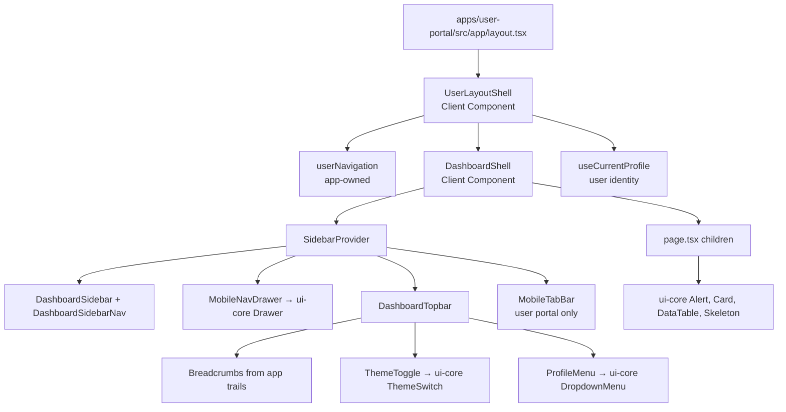

# Shared dashboard architecture

The dashboard applications share two packages with different responsibilities. `@template/ui-core` provides the design-system component foundation (Trello FE-UI-003; full API in [shared-components.md](../design-system/shared-components.md)): `cn`, a curated Lucide icon set, `Button`/`IconButton`, `Badge`, `Chip`, `Avatar`, `IconTile`, `Progress`, `Spinner`, `Divider`, `Card*`, `Panel`, `Stat`/`StatGrid`, `KeyValueList`, `ListRow`, native-first form controls (`Input`, `Select`, `Textarea`, `SearchInput`, `PasswordInput`, `OtpInput`, `Checkbox`, `RadioGroup`/`RadioCard`, `Switch`, `SegmentedControl`, `FormField`), Radix-based `Dialog`/`ConfirmDialog`, `Drawer`, `DropdownMenu`, `Tooltip` and `Tabs`, `DataTable`, `Pager`, `Alert`, skeletons and `EmptyState`/`ErrorState`. Deprecated compatibility APIs (`buttonClassName`, `Modal`, `Pagination`, `StatusBadge`, `IconContainer`, `StatCard`, `SectionHeader`, `SettingsRow`) render through the new implementations until their consumers migrate. `Alert` centralizes success, error, warning, and informational presentation, optional dismissal, timed exit animation, and reduced-motion behaviour while leaving message state and copy in the consuming feature. `@template/dashboard-ui` provides the dashboard frame and navigation-oriented components (Trello FE-UI-004, design revision `a7e2a63`): `DashboardShell`, `DashboardSidebar`/`DashboardSidebarNav` (grouped), `DashboardTopbar`, `MobileNavDrawer`, `MobileTabBar`, `DashboardBrand`, `ThemeToggle`, `Breadcrumbs`, `ProfileMenu`/`AccountSummary`, the page header (`DashboardHeader`) and pure active-route helpers (`isNavItemActive`, `resolveActiveNavHref`), plus chart foundations at `@template/dashboard-ui/charts`. `dashboard-ui` depends on `ui-core` for icons and presentation primitives; the reverse dependency is not allowed. Both retain TailAdmin attribution.

Neither package owns User Portal or Admin Portal navigation. `userNavigation` and `adminNavigation` remain in their respective `apps/*/src/config/navigation.ts` files; the apps pass them to shared components as typed `DashboardNavItem[]` or `DashboardNavGroup[]`. Production navigation lists only implemented routes (an app test checks that each entry has a `page.tsx`); the complete reference navigation exists only as UI workbench fixtures. That is what prevents a privileged admin destination from leaking into user navigation. Their focused Vitest tests check that distinction.

## Composition trace

Admin Portal follows the same shape through `AdminLayoutShell`, but supplies grouped navigation, an "Admin" brand chip, breadcrumbs and a sign-out-only account menu, and has no tab bar. It has no identity read yet, so it shows the admitted role ("Administrator"). Each shell maps its app-owned navigation hrefs to `ui-core` icons, so `navigation.ts` stays plain data. The architecture deliberately shares the frame while keeping product-specific composition local.

## Sidebar state and responsive behaviour

`DashboardShell` installs `SidebarProvider`, then `DashboardFrame` reads its state through `useSidebar`. The provider stores two pieces of state:

- `isExpanded`: from the `lg` breakpoint the sidebar is 260px (`w-sidebar`) with icons and labels when true, and a 72px icon rail (`w-sidebar-collapsed`) when false. The content column offsets itself with the same tokens (`lg:pl-sidebar*`), so widths are defined once in `theme.css`. `SidebarProvider` accepts `defaultExpanded` (default `true`).
- `isMobileOpen`: below `lg` navigation lives in `MobileNavDrawer`, a modal `ui-core` `Drawer` (Radix Dialog): focus trap and return, Escape, scrim click, page scroll lock, inert background. Selecting a navigation item closes it, and a `matchMedia` listener closes it when the viewport grows to `lg`. It starts closed.

Breakpoints: phone below `md` (top bar, tab bar for the user portal, drawer), tablet `md`–`lg` (top bar with breadcrumbs and the drawer), desktop from `lg` (persistent sidebar). `DashboardSidebar` is `hidden lg:flex`, so its links are not focusable below `lg`; its navigation scrolls inside the sidebar while the brand and footer stay put. `DashboardSidebarNav` renders optional labelled groups, 44px rows and 20px icons, and marks exactly one item current: the most specific `href` that is the page or an ancestor (`resolveActiveNavHref`; `/` matches only itself; `/billing` does not match `/billing-archive`). In the rail, labels become Radix tooltips and each link gets `aria-label`; group labels stay as screen-reader text and render as dividers.

`DashboardTopbar` is the sticky application bar (68px desktop, 64px phone minimums with the reference padding around 44px controls): the menu button (below `lg`) or the collapse button (from `lg`), the brand (below `lg`), breadcrumbs (from `md`), the bordered theme switch (from `md`; on phones it is the drawer's Dark mode switch) and app `actions` such as `ProfileMenu`. It is distinct from `DashboardHeader`, the page heading inside the content area. `ProfileMenu` is a Radix dropdown: keyboard navigation, Escape and outside-click dismissal, focus return; each action must spread the props it receives (the apps' `LogoutButton` does). `main` (`#main-content`, with a skip link) is max 1280px with 32px padding (20×16px on phones) and is not centred, as in the reference. Layers: top bar and sidebar `z-sticky`, tab bar `z-tabbar`, drawer scrim/panel `z-overlay`/`z-drawer`, menus `z-popover`, tooltips `z-tooltip`.

The shell components are client modules (context, media queries, event handlers). `Breadcrumbs`, `DashboardHeader` and `DashboardBrand` are server-renderable; all app-specific values are supplied by the app shells.

## Page and settings conventions

- Start a dashboard page with `DashboardHeader`: an optional `icon` in a 48px brand-tinted tile, a 28px title, and a 14px description, directly on the page background rather than in a card. `eyebrow` remains available for pages that use it.
- Build new sections as `Card` with `CardHeader` (title, description, actions) and `CardContent`/`CardFooter`; put rows in `ListRow`, pairs in `KeyValueList`, state in a `Badge` whose text carries the meaning, and use `EmptyState`/`ErrorState`/skeletons for asynchronous states. Existing pages still use `SectionHeader`, `SettingsRow` and `StatusBadge`, which now render through the new components.
- Use `Button` (`primary`, `secondary`, `ghost`, `danger`, `dangerOutline`; `sm`; `loading`; `asChild` for links) or `buttonVariants` for button-styled elements. The legacy `buttonClassName` maps `destructive` → `dangerOutline`, `danger` → `danger` and `accent` → `secondary`. Use `ConfirmDialog` for destructive confirmations; existing `Modal` consumers keep their props on the accessible `Dialog` (focus trap and return, Escape, scroll lock).
- Feature-specific compositions stay in the app. The User Portal Security page (`apps/user-portal/src/app/security`) is the reference implementation.

## Theme and primitive boundary

Shared visual foundations live in `packages/ui-core/src/styles/theme.css`, exported as `@template/ui-core/theme.css` and imported by all three apps: a palette tier, semantic colour tokens swapped under `.dark` (`bg-surface`, `text-fg-muted`, `border-border`, `bg-brand`, `bg-success-bg`, chart and nav tokens), the type scale, recurring sizes, radius, elevation, layers, a global `:focus-visible` outline and reduced-motion rules. Dark mode is class-based: the `ui-core` `ThemeProvider` (`next-themes`, system default, storage key `theme`), composed in each app's `AppProviders`, sets `.dark`/`.light` on `<html>` before first paint. `ThemeToggle` renders the shared `ThemeSwitch`. Root layouts load Outfit and JetBrains Mono with `next/font/google` (self-hosted) as `--font-outfit-loaded` / `--font-jetbrains-mono-loaded`, which the theme maps to `--font-sans` / `--font-mono`.

`packages/dashboard-ui/src/tailadmin-theme.css` (exported as `@template/dashboard-ui/tailadmin-theme.css`) is now a temporary compatibility layer imported after the shared theme. It keeps the `brand-*` scale (pointing at the shared blue palette), the slate `gray-*` scale, `shadow-theme-*` and `no-scrollbar` that existing components still pair with `dark:` variants. New and migrated components use only semantic utilities; see [design foundations](../design-system/foundations.md). Application `globals.css` resets (`a { color: inherit }` and similar) live inside `@layer base` so Tailwind utilities can override them. Both dashboard application global stylesheets tell Tailwind to scan the shared source directories.

Use `ui-core` for domain-neutral controls and display primitives. Use `dashboard-ui` for a reusable dashboard layout or navigation presentation. Put application labels, routes, profile data, permissions, and API-backed behaviour in an app. The current page tables are empty-state examples, not connected account, authorization, audit, or health workflows.
