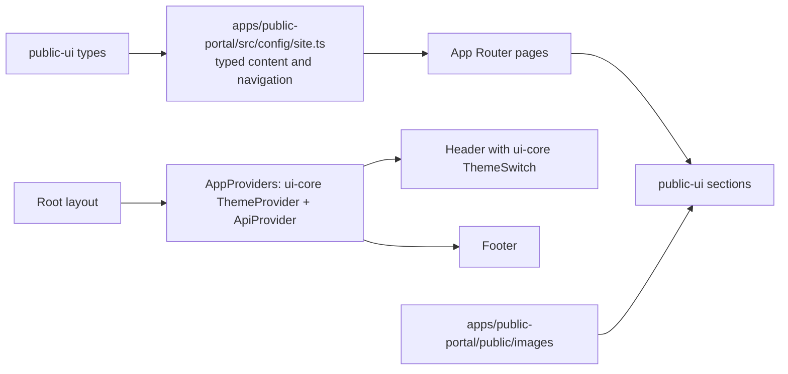

# Public portal architecture

`apps/public-portal` is a separately deployable marketing application. It depends on `@template/public-ui`, not on dashboard packages, so its `framer-motion` dependency does not become a dependency of the authenticated dashboard applications. Theme management (`next-themes`) comes from `@template/ui-core`, shared with the dashboards. Its source and assets are Solid-derived, with the required MIT notices preserved in both the app and package license files.

## Typed rendering and application-owned content

`packages/public-ui/src/types.ts` defines reusable props such as `LinkItem`, `FeatureItem`, `PricePlan`, `FaqItem`, `TestimonialItem`, `LogoItem`, and `BlogPost`. The package barrel exports those types plus reusable sections including `Hero`, `Features`, `Pricing`, `Faq`, `Testimonials`, `Header`, and `Footer`.

`apps/public-portal/src/config/site.ts` supplies the actual navigation, actions, branding, contact values, features, optional plan marketing copy, FAQs, testimonials, logo assets, and posts. Pages compose that typed configuration into the shared sections. This is the key boundary: public-ui decides how a typed section renders; the application decides the site's wording, destinations, and which sections appear on a page.

The root layout wraps all pages with `AppProviders` (the shared `ui-core` `ThemeProvider` around the API provider), `Header`, and `Footer`. The theme provider places the selected or system theme on the HTML class before first paint. The Header is a Client Component: it handles responsive menu state, active pathname styling and scroll-based sticky presentation, and renders the shared `ThemeSwitch`. The remaining page composition can stay server-rendered.

## Routes, metadata, and assets

The landing page composes Hero, logo cloud, features, CTA, FAQ, testimonials, pricing, contact, and post cards. Pricing on the landing and `/pricing` pages comes from the backend through `SubscriptionPricing` (see [Subscriptions and billing](./11-subscriptions-and-billing.md)); the shared `Pricing` section accepts a `placeholder` for loading, empty, and error states. Feature, pricing, about, contact, and blog pages reuse shared components with page-level metadata; privacy and terms use app-local `LegalPage` placeholder content. `not-found.tsx` uses the bundled 404 asset. `robots.ts` and `sitemap.ts` derive URLs from `site.url`; sitemap values use the current build/request time for `lastModified`.

`layout.tsx` creates canonical metadata from `site.url`, selects `public/images/favicon.ico`, and wraps each route. Static images live under `apps/public-portal/public/images` and are referenced as `/images/...` through `next/image` or CSS.

## Styling and external destinations

The Public Portal global stylesheet imports Tailwind and declares `@source "../../../../packages/public-ui/src"`, allowing Tailwind to generate classes found in shared section source. It imports `@template/ui-core/theme.css` (shared tokens, dark variant, Outfit/JetBrains Mono font stacks), scans only `ui-core`'s theme controls and icons, and keeps the Solid-derived tokens (with Solid's previous radii pinned) for the un-migrated sections. The root layout loads Outfit and JetBrains Mono with `next/font`. `/foundations` is a development-only specimen of the shared tokens (404 in production builds). The public app’s `env.ts` normalizes `NEXT_PUBLIC_API_BASE_URL` and `NEXT_PUBLIC_USER_PORTAL_URL`, and validates the browser tenant used by its API client; `userPortalHref` builds the Header sign-in/register destinations. The current unit test verifies that helper rather than a real authentication flow.

Plan prices, currencies, and intervals are backend-authoritative; each plan CTA links to the User Portal checkout with its `planId`, and the User Portal owns authentication and checkout. Legal text, testimonials, and contact content remain configurable placeholders. No form submission, blog backend, or authentication implementation exists in the Public Portal. Plans are loaded by Server Components through an anonymous server API client (runtime `API_BASE_URL` and `TENANT_ID`), so the browser never calls the API for them. It depends on `@template/ui-core` for the shared theme, theme controls and the minor-unit money formatter.
