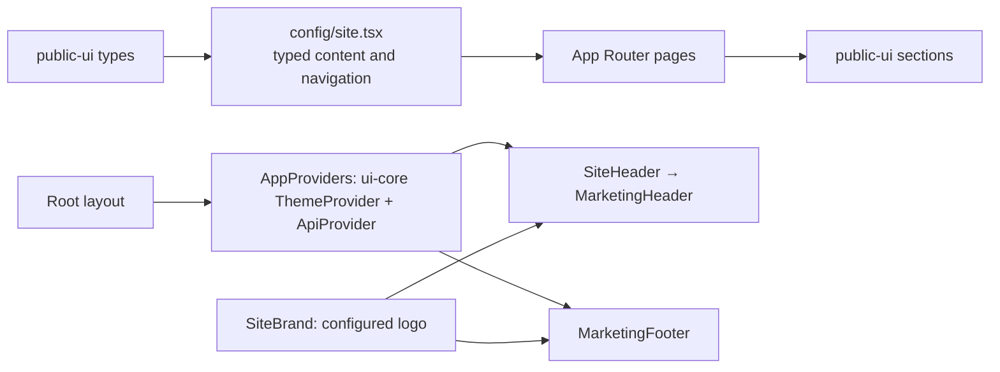

# Public portal architecture

`apps/public-portal` is a separately deployable marketing application. It depends on `@template/public-ui` (marketing presentation) and `@template/ui-core` (tokens, theme, primitives), not on dashboard packages. Since FE-UI-005 (roadmap FE-UI-009/010/011) the site follows the `1-marketing-site` references of the Project Template design system and uses only the shared semantic tokens; the Solid-derived sections, tokens, images and the `framer-motion` dependency were removed. The package-level `LICENSE.solid` notices are kept until OD-06 decides their removal.

## Typed rendering and application-owned content

`packages/public-ui/src/types.ts` defines content props: `LinkItem`, `Action` (a link with an optional `primary`/`secondary` variant), `FeatureItem`, `PricePlan`, `FaqItem`, `BlogPost`, `FooterLinkGroup`, `ContactDetail` and `LegalSection`. The package exports:

| Component                                                          | Purpose                                                                                                                                        |
| ------------------------------------------------------------------ | ---------------------------------------------------------------------------------------------------------------------------------------------- |
| `MarketingHeader`, `MarketingMobileMenu`                           | Top bar (full navigation from `lg`); full-screen menu sheet below `lg` on the ui-core `Drawer`, with Sign in, Get started and `DarkModeSwitch` |
| `MarketingFooter`                                                  | Brand, description, labelled link groups, copyright                                                                                            |
| `MarketingContainer`, `MarketingSection`                           | 1200px wrap; 80px/48px section with an optional `alt` surface band                                                                             |
| `Hero`, `SectionHeading`                                           | Centred page hero (`home`/`page` sizes) and section headings                                                                                   |
| `FeatureGrid`, `NumberedFeatureList`                               | Feature cards; numbered alternating capability list                                                                                            |
| `ProductShot`                                                      | Decorative, `aria-hidden` illustration with no figures                                                                                         |
| `CtaBanner`                                                        | Brand call-to-action panel                                                                                                                     |
| `PlanCard`, `PlanGrid`, `PlanGridSkeleton`, `PricingIntervals`     | Plan cards, their loading placeholder, and the billing-interval switch over prepared plan lists                                                |
| `FaqGrid`, `BlogCard`/`BlogGrid`, `ContactLayout`, `LegalDocument` | Questions grid, blog cards, contact layout, legal document with table of contents and document switch                                          |

Components render supplied data only; they never fetch, route or read the pathname. The brand lockup is passed in as a node, so the app keeps its configured logo.

`apps/public-portal/src/config/site.tsx` supplies navigation, footer groups, legal documents, actions, feature and capability lists (with ui-core icons), FAQs, posts and optional plan marketing copy. Pages compose that configuration into the shared sections: public-ui decides how a section renders; the application decides wording, destinations and which sections a page shows.

The root layout wraps all pages with `AppProviders`, `SiteHeader` and `MarketingFooter`. `SiteHeader` is the app's Client Component that reads `usePathname()` and marks the current item (`activeNavigationHref`, `src/lib/navigation.ts`); `MarketingHeader` owns only the menu's open state. The mobile menu traps focus, makes the page inert, closes on Escape, the close button, choosing a link, or growing to `lg`, and returns focus to the menu button.

## Routes, metadata, and assets

| Route                | Composition                                                                                           |
| -------------------- | ----------------------------------------------------------------------------------------------------- |
| `/`                  | Hero, product shot, feature grid, CTA (static; no plan request)                                       |
| `/features`          | Page hero and numbered capability list (only implemented capabilities, DR-031)                        |
| `/pricing`           | Page hero, backend plans streamed behind `PlanGridSkeleton`, questions grid                           |
| `/about`, `/blog`    | Page hero with cards; blog cards keep `#launch`-style anchors and do not link (no post pages, DR-032) |
| `/contact`           | Contact form and detail cards                                                                         |
| `/privacy`, `/terms` | `LegalDocument`; the Privacy/Terms switch is two links with `aria-current` (DR-034)                   |

Every page keeps its metadata and canonical URL. `robots.ts` and `sitemap.ts` derive URLs from `site.url`; a test checks that every navigation, footer and legal link has a `page.tsx` and a sitemap entry. `not-found.tsx` is a token-styled message. Static assets are only the configured logo and favicon under `public/images`.

## Styling and external destinations

`globals.css` imports Tailwind and `@template/ui-core/theme.css` and declares `@source` for `public-ui` and `ui-core`; there is no app-specific token layer. The root layout loads Outfit and JetBrains Mono with `next/font`. `/foundations` is a development-only token specimen. `env.ts` normalizes `NEXT_PUBLIC_USER_PORTAL_URL`; `userPortalHref` builds the Sign in (`/sign-in`) and Get started (`/register`) destinations.

Plan prices, currencies, and intervals are backend-authoritative (see [Subscriptions and billing](./11-subscriptions-and-billing.md)). There is no contact endpoint (DR-033): the contact form builds a `mailto:` link to the support email (`src/lib/contact-mailto.ts`) and states that nothing is sent from the site. Legal and blog content remain configurable placeholders. No blog backend or authentication implementation exists in the Public Portal.
