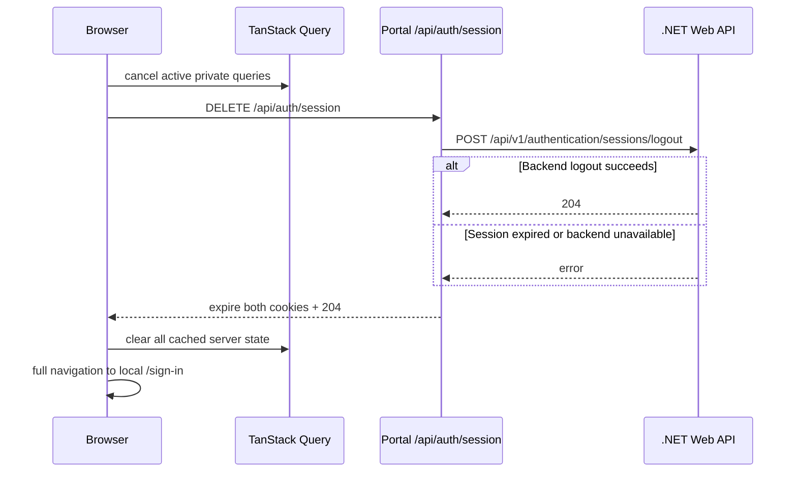
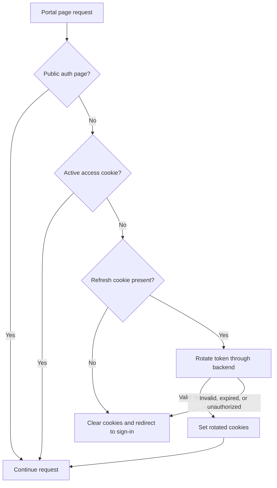

# Authentication and session management

FE-021 added sign-in to the User and Admin portals, FE-022 tightened session storage, FE-023 added coordinated refresh, FE-024 added explicit logout, FE-025 protected dashboard routes, FE-030 added authenticated password changes, CAF-FE-004 added authenticator two-factor authentication to the User Portal, and CAF-FE-005 added passkey (WebAuthn) registration, management, and passwordless sign-in. Each portal owns its `/sign-in` page, validates the form with `@template/forms`, and sends credentials to its own `/api/auth/session` Route Handler. The User Portal also owns the public `/register`, `/confirm-email`, and `/sign-in/two-factor` routes. Access and refresh tokens stay on the server side and are never returned to browser JavaScript.

## Sign-in flow

```mermaid
sequenceDiagram
  participant Browser
  participant Portal as Portal /api/auth/session
  participant Backend as .NET Web API
  Browser->>Portal: POST email + password
  Portal->>Backend: POST /api/v1/authentication/sessions + X-Tenant-Id
  alt authenticated
    Backend-->>Portal: access + refresh tokens
    Portal-->>Browser: HttpOnly session cookies + safe metadata
  else two_factor_required (User Portal)
    Backend-->>Portal: opaque challenge + expiry
    Portal-->>Browser: HttpOnly challenge cookie + safe expiry
    Browser->>Portal: POST code to /api/auth/session/two-factor
    Portal->>Backend: code + cookie-held challenge
    Backend-->>Portal: access + refresh tokens
    Portal-->>Browser: expire challenge; set session cookies
  end
  Browser->>Browser: replace with validated returnTo path
```

The form maps response status to application-owned, safe messages. It does not render backend details, account identifiers, tokens, or exception text. `returnTo` accepts only a same-origin absolute path beginning with one slash; missing, external, protocol-relative, and malformed values fall back to `/`. This supplies destination restoration for route guards without creating an open redirect.

When credential sign-in reports that the email is not confirmed, the User Portal does not leave the customer on an error state. It requests a confirmation code, carries the returned resend cooldown and validated `returnTo` destination into `/confirm-email`, and lets the customer complete verification. Successful verification creates the session and continues directly to the validated destination instead of returning to sign-in.

The portal's server API client adds the configured `X-Tenant-Id` header to sign-in, refresh, logout, registration, and every other backend operation. Route protection uses the same server tenant setting. The shared configuration defaults to the template tenant and still allows a deployment-specific override.

## Google authentication

The User Portal exposes one `Continue with Google` entry on both `/sign-in` and `/register`. Both entries use the same Google Identity Services (GIS) flow; the page on which it starts does not decide whether the customer is signing in or registering. The .NET backend verifies the Google credential and returns the authoritative `authenticated`, `two_factor_required`, `link_required`, or `registration_required` outcome.

Rendering either page only loads GIS. The same-origin flow-start request is deferred until the customer explicitly activates `Continue with Google`; the returned nonce is then supplied to GIS before the official Google button is rendered. The customer activates that GIS-owned button to open Google's popup. This explicit preparation step prevents passive page visits, React development remounts, or unrelated form interaction from consuming the backend sign-in rate limit. The portal does not use the Google One Tap prompt as a substitute for the button because its FedCM lifecycle and status callbacks do not match this server-issued, per-attempt nonce flow.

```mermaid
sequenceDiagram
  participant Browser
  participant BFF as User Portal BFF
  participant Google as Google Identity Services
  participant Backend as .NET Web API
  Browser->>BFF: POST /api/auth/google/flow
  BFF->>Backend: POST /api/v1/authentication/google/flows
  Backend-->>BFF: opaque flow token + nonce + expiry
  BFF-->>Browser: nonce + expiry; flow token in HttpOnly cookie
  Browser->>Google: GIS request with public client ID + nonce
  Google-->>Browser: ID credential
  Browser->>BFF: POST credential to /api/auth/session/google
  BFF->>Backend: ID token + cookie-held flow token
  alt authenticated
    Backend-->>BFF: application access + refresh tokens
    BFF-->>Browser: normal session cookies + safe metadata
  else two_factor_required
    Backend-->>BFF: opaque MFA challenge + expiry
    BFF-->>Browser: HttpOnly MFA cookie + safe expiry
    Note over BFF: Google flow cookie is cleared
  else link_required
    Backend-->>BFF: stable continuation outcome
    Browser->>BFF: existing password to /api/auth/google/link
    BFF->>Backend: password + cookie-held flow token
    Backend-->>BFF: application access + refresh tokens
    BFF-->>Browser: normal session cookies + safe metadata
  else registration_required
    Backend-->>BFF: stable continuation outcome
    Browser->>BFF: first name + last name + country
    BFF->>Backend: profile + cookie-held flow token
    Backend-->>BFF: application access + refresh tokens
    BFF-->>Browser: normal session cookies + safe metadata
  end
```

The temporary `__Host-user-google-auth-flow` cookie is `HttpOnly`, `Secure`, `SameSite=Lax`, host-only, path-rooted, and expires with the backend's five-to-ten-minute flow lifetime. Browser JavaScript receives the nonce but never the opaque flow token. The Google ID credential exists only in the GIS callback long enough to post to the same-origin BFF; it is not decoded as trusted identity, persisted, or put in a URL. The BFF clears the flow cookie after successful authentication, after ownership passes to an MFA challenge, and on terminal invalid, expired, or consumed flow errors. It preserves the cookie only for the link and registration continuation outcomes.

An existing Google link creates the normal application session immediately. An existing password account switches to a password-confirmation form and links through the backend before issuing that same session. A new account collects only editable first name, last name, and country values; it does not ask for the Google email or a password. All three successful paths use `setSessionCookies(...)`, return only expiry/token-type metadata, and apply the existing validated `returnTo` redirect. Stable backend codes drive invalid-credential, expired/invalid flow, locked-account, email-verification, and rate-limit presentation; UI code never parses ProblemDetails English text.

## Authenticator two-factor authentication

Password and Google authentication now share the same boundary between a successful first factor and a fully authenticated application session. The backend returns a discriminated `authenticated` result with tokens or `two_factor_required` with an opaque challenge and expiry. For the latter, the User Portal BFF clears any stale session cookies, stores the challenge and its expiry in the short-lived `__Host-user-two-factor-challenge` cookie, and returns only `{ status, expiresAtUtc }` to browser JavaScript. The challenge is never placed in React state, TanStack Query, browser storage, logs, or a URL.

`/sign-in/two-factor` is a public continuation page. It reads only safe challenge metadata through `GET /api/auth/session/two-factor`; authenticator and recovery-code submissions contain only the verification method and code. `POST /api/auth/session/two-factor` adds the cookie-held challenge before calling the backend. A successful response creates the normal access and refresh cookies and expires the challenge cookie. Incorrect codes preserve the challenge while attempts remain; expired, consumed, invalid, or exhausted challenges clear it. `DELETE` cancels locally and lets the customer restart. The validated `returnTo` path is preserved, but no sensitive continuation value is included in it.

The `/security` page owns authenticator management. Its browser API adapter maps the handwritten authenticated operations to same-origin BFF routes for status, setup, enrollment verification, recovery-code regeneration, and disable. Setup secrets and generated recovery codes exist only in the mounted UI/mutation result; the sensitive mutations use zero cache retention and are reset when their one-time result is dismissed. QR rendering uses the backend-provided `otpauth://` URI, and the manual key is never copied into storage or analytics. Regeneration and disable require a current authenticator or recovery-code proof and invalidate the shared two-factor status query.

ASP.NET Core Identity remains the owner of authenticator secrets and single-use recovery codes. The frontend never persists either value and cannot redisplay recovery codes after the user dismisses them; regeneration is the only way to obtain a new set.

## Passkeys

Passkeys use the backend's ASP.NET Core Identity WebAuthn implementation. Browser JavaScript only runs the native WebAuthn ceremony; the backend issues every challenge, keeps the ceremony state behind an opaque single-use `flowToken`, and verifies attestation and assertion responses. The frontend never sees credential private keys and implements no cryptography.

| Operation                                           | Backend endpoint                                                  | Browser path                                           |
| --------------------------------------------------- | ----------------------------------------------------------------- | ------------------------------------------------------ |
| Registration options (`{ name }`)                   | `POST /api/v1/authentication/passkeys/registration-options`       | `POST /api/security/passkeys/registration-options`     |
| Complete registration (`{ flowToken, credential }`) | `POST /api/v1/authentication/passkeys/registrations`              | `POST /api/security/passkeys/registrations`            |
| List passkeys                                       | `GET /api/v1/authentication/passkeys`                             | `GET /api/security/passkeys`                           |
| Rename (`{ name }`) / remove                        | `PATCH`/`DELETE /api/v1/authentication/passkeys/{credentialId}`   | `PATCH`/`DELETE /api/security/passkeys/{credentialId}` |
| Sign-in options                                     | `POST /api/v1/authentication/passkeys/authentication-options`     | `POST /api/auth/passkey/options`                       |
| Complete sign-in (`{ flowToken, credential }`)      | `POST /api/v1/authentication/passkeys/authentication-completions` | `POST /api/auth/session/passkey`                       |

### Registration and management

```mermaid
sequenceDiagram
  participant Browser
  participant BFF as User Portal /api/security/passkeys
  participant Backend as .NET Web API
  Browser->>BFF: POST registration-options { name }
  BFF->>Backend: bearer token from HttpOnly cookie
  Backend-->>Browser: flowToken + WebAuthn creation options + expiry
  Browser->>Browser: base64url to ArrayBuffer; navigator.credentials.create()
  Browser->>BFF: POST registrations { flowToken, attestation JSON }
  BFF->>Backend: verify challenge, origin, attestation; store credential
  Backend-->>Browser: 201 passkey metadata
  Browser->>Browser: invalidate the passkeys query
```

The Security page's General tab hosts the Passkeys card. The friendly name is collected before the ceremony because the backend binds it to the registration flow; renaming later uses the PATCH endpoint. Registration is repeatable, and the backend's `excludeCredentials` makes an authenticator that already holds a passkey for the account fail with `InvalidStateError`, which is shown as a duplicate. The registration flow token is bound server-side to the authenticated user, stakeholder, and tenant, so it travels through browser memory only for the duration of one ceremony; its mutation result is not retained in the query cache. Rows show only backend-supplied metadata: name, creation date, transport hints, and synced/backup state. The backend does not return a last-used date, so none is displayed. Removal requires a confirmation dialog. Registration, rename, and removal invalidate only `['authentication', 'security', 'passkeys']`; no optimistic updates are used. Every management call is authenticated through `/api/security/**`, so an expired access token uses the normal coordinated refresh, and the backend scopes each credential ID to the signed-in user.

### Passwordless sign-in

The backend issues discoverable-credential (username-less) options, so `Sign in with passkey` needs no email. Password and Google sign-in are unchanged and remain available.

```mermaid
sequenceDiagram
  participant Browser
  participant BFF as User Portal BFF
  participant Backend as .NET Web API
  Browser->>BFF: POST /api/auth/passkey/options
  BFF->>Backend: POST authentication-options + X-Tenant-Id
  Backend-->>BFF: flowToken + WebAuthn request options + expiry
  BFF-->>Browser: request options only; flowToken in HttpOnly cookie
  Browser->>Browser: navigator.credentials.get(); serialize assertion
  Browser->>BFF: POST /api/auth/session/passkey { credential }
  BFF->>Backend: assertion + cookie-held flowToken
  alt authenticated
    Backend-->>BFF: access + refresh tokens
    BFF-->>Browser: setSessionCookies(...) + safe metadata
  else two_factor_required
    Backend-->>BFF: opaque MFA challenge + expiry
    BFF-->>Browser: existing HttpOnly two-factor challenge cookie
  end
  Note over BFF: the passkey flow cookie is cleared after every completion attempt
  Browser->>Browser: validated returnTo, or /sign-in/two-factor
```

The `__Host-user-passkey-sign-in-flow` cookie is `HttpOnly`, `Secure`, `SameSite=Lax`, host-only, path-rooted, and expires with the backend flow. The backend consumes a flow on its first completion attempt, so the BFF clears the cookie after success, two-factor continuation, and every failure. If the user cancels the native prompt, the browser calls `DELETE /api/auth/session/passkey` to clear it. Passkey sign-in does not bypass MFA: a `two_factor_required` outcome reuses the existing challenge cookie and `/sign-in/two-factor` page. The passkey endpoint names the access-token expiry `accessTokenExpiresAtUtc`, unlike the other session endpoints, so the BFF adapts it to the shared session shape and then calls the same `setSessionCookies` used by password and Google sign-in. No new session format exists. Passkey BFF responses are sent with `Cache-Control: no-store`, and assertions are never logged.

### Errors and compatibility

Both entry points use `isWebAuthnSupported()`, which requires a secure context, `PublicKeyCredential`, and `navigator.credentials`. Unsupported browsers see a disabled control with an explanation, while other methods stay usable. Native `NotAllowedError`/`AbortError` is treated as normal cancellation: no error banner is shown, nothing is logged, and pending state is cleared. Browsers intentionally report "no matching passkey" and timeouts the same way. Passkey errors carry no stable backend `code`, so copy is chosen by HTTP status:

| Status | Registration                                     | Sign-in                               |
| ------ | ------------------------------------------------ | ------------------------------------- |
| 400    | Invalid attestation or name validation           | Invalid flow or credential payload    |
| 401    | Session expired (refresh, then sign-in redirect) | Assertion rejected                    |
| 403    | Session cannot manage passkeys                   | Email not verified or tenant mismatch |
| 409    | Flow already used or duplicate credential        | Flow already used (replay)            |
| 410    | Challenge expired                                | Challenge expired                     |
| 423    | —                                                | Account locked                        |

Messages are app-owned, actionable, and distinct from password-failure copy. Backend details are never shown.

### Testing

`webauthn.test.ts` covers base64url round trips, invalid input, option conversion, registration and assertion serialization including optional and null fields, support detection, and error classification against injected WebAuthn environments. `passkey-operations.test.ts` checks HTTP paths, methods, bodies, and encoded credential IDs at the MSW boundary. `passkeys.test.ts` in `api-react` checks query keys and passkey-only invalidation. User Portal tests cover the browser-to-BFF workflows with injected fetch and ceremony functions, the BFF routes (cookie attributes, token-free payloads, two-factor hand-off, and failures that never create a session), browser API rewrites, and static rendering of the card and sign-in control. No physical authenticator is required.

## Registration and email confirmation

The User Portal implements registration as an app-owned three-step workflow. It first posts the normalized email to `/api/v1/authentication/email-existence-checks`. Existing accounts are sent to `/sign-in` with a validated email query value, which pre-populates the email field and leaves the password field ready. New accounts continue to first name, last name, and a searchable country selector before creating their password on the final step. The selector reads public reference data and submits the selected country's UUID as `countryId`.

The password schema mirrors the Web API rules: at least eight characters with an uppercase letter, lowercase letter, digit, and non-alphanumeric character. Confirmation must match. This gives immediate guidance, while backend validation remains authoritative and is mapped back to the known fields.

The completed payload is sent through the handwritten `authentication.signUp` operation. An accepted registration navigates to `/confirm-email` with the email address and the backend's `retryAtUtc` cooldown. The page presents the six-character code as six coordinated inputs. It sends the combined value to its same-origin `/api/auth/email-confirmations` Route Handler, which calls the handwritten backend operation, stores the returned session tokens in HttpOnly cookies, and returns only non-sensitive session metadata to the browser. Its resend action remains disabled until five seconds after the backend timestamp to absorb small client/server clock differences, then calls `authentication.requestEmailConfirmationCode` and replaces the cooldown with the returned `retryAtUtc`. Successful confirmation continues directly to the validated destination; registration defaults to `/dashboard`. A conflict during the final registration request is treated like an existing-email result, covering the race between the initial check and submission.

## Session cookie policy

Each portal keeps the access and refresh token in separate cookies. Only Route Handlers and server API clients read them.

| Portal | Access token           | Refresh token                  |
| ------ | ---------------------- | ------------------------------ |
| User   | `__Host-user-session`  | `__Host-user-refresh-session`  |
| Admin  | `__Host-admin-session` | `__Host-admin-refresh-session` |

All four cookies are `HttpOnly`, `Secure`, `SameSite=Lax`, `Path=/`, and high priority. The `__Host-` prefix also prevents a `Domain` attribute, so these cookies cannot be widened to sibling subdomains. The User and Admin names are deliberately different because browser cookies are not isolated by port during local development.

Google authentication and MFA additionally use the short-lived `__Host-user-google-auth-flow` and `__Host-user-two-factor-challenge` continuation cookies described above. Neither is an application session and neither can authorize protected requests.

Cookie expiry is the backend token expiry minus 60 seconds. That buffer stops the portals from using a token right at the edge of its validity and gives refresh coordination a clear point to refresh early. The refresh cookie is persistent, so reloading or reopening the browser does not lose it before that adjusted expiry. Authentication tokens are never written to `localStorage` or `sessionStorage`; the dashboard theme is the only current `localStorage` consumer.

`src/lib/session-cookies.ts` is the single place that creates and clears these cookies. Login, Google login, and refresh rotation use the same setter. Logout and terminal refresh failures use the same clearer. Secure cookies work on `localhost` during development; every non-local deployment must use HTTPS.

## Refresh coordination

Both portals export `authenticatedFetch` from `src/lib/api.ts` for client workflows that call a same-origin BFF endpoint. Each portal configures the reusable `createBffSessionFetch` helper from `@template/api-client/browser` with its authentication, session, and sign-in paths. The helper delegates concurrency and retry decisions to `createRefreshCoordinatedFetch`; neither helper replaces the global `fetch` function or attaches portal cookies to the backend API origin.

When an eligible request returns 401, the wrapper posts to `/api/auth/session/refresh`. Requests that fail together wait on the same refresh promise. A successful refresh rotates the cookies, increments an in-memory session version, and lets every waiting request retry once. The version check also covers a late 401 from a request sent before another request completed the refresh.

The retry uses the underlying Fetch implementation instead of calling the wrapper again. If that retry also returns 401, the session ends without another refresh attempt. Authentication routes, the sign-in page, and cross-origin requests never enter refresh coordination, which removes the other paths that could create a loop.

If refresh fails for any reason, the refresh Route Handler clears both cookies. The browser then makes a best-effort `DELETE /api/auth/session` call and redirects to `/sign-in` with the current local path in `returnTo`. Concurrent failures share that cleanup and redirect as well as the refresh request.

Refresh rotation never starts or repeats MFA. Once second-factor verification has created a backend `AuthenticationSession`, the existing access/refresh rotation behaves exactly like any other authenticated session. Security-sensitive MFA changes may invalidate that session in the backend; the existing refresh-failure path then clears cookies and returns the user to sign-in.

Authenticated client-side features must use `authenticatedFetch` for their same-origin Route Handler calls. The User Portal supplies that fetch implementation to its `browserApi` adapter and rewrites the profile update operation to `/api/profile`; public and CORS-approved operations retain their backend URLs. The local handler uses the server client to attach the HttpOnly access token, so browser JavaScript never receives authentication cookies or token material.

## Logout flow



Each portal adds an app-owned `LogoutButton` to its profile menu. `src/lib/logout.ts` cancels active queries, calls the same-origin session endpoint, clears the Query Client, and navigates to the current portal's `/sign-in` page. The full navigation resets React authentication and refresh-coordination state as well as the in-memory cache.

The Route Handler always attempts the backend logout operation. It also always expires that portal's access and refresh cookies and returns `204`, including when the backend reports an already-expired session or cannot complete the request. Local sign-out therefore does not depend on a usable access token or backend availability. The reusable `@template/api-react` logout mutation clears a supplied Query Client in `onSettled` for consumers that call the API client directly; portal navigation and safe error behaviour remain application-owned.

## Security settings

The protected User Portal `/security` page collects the current password, a new password, and its confirmation. Local validation mirrors the registration policy and also requires the new password to differ from the current value. The form clears every password field after a successful change and displays only normalized, safe errors. Structured backend policy errors are mapped to the matching field; the application does not log or cache submitted password values.

Browser requests use the `authentication.changePassword` mutation, which the User Portal adapter rewrites to `PUT /api/security/password`. That same-origin Route Handler sits outside the reserved `/api/auth/` session-management prefix, so an expired access token enters the normal coordinated refresh-and-retry flow. The handler reads the HttpOnly session through the request-scoped server client and forwards `PUT /api/v1/authentication/password` with `{ currentPassword, newPassword, confirmNewPassword }`. The expected backend success response is `204 No Content`. The backend operation is the authoritative source for current-password verification and password-policy outcomes; its implementation and OpenAPI contract must use this shape before the integrated flow can succeed.

Two-factor and passkey management follow the same authenticated BFF rule under `/api/security/two-factor/**` and `/api/security/passkeys/**`; React never attaches or reads the access token directly.

## Protected routes

Each dashboard app exports a Next.js `proxy` from `src/proxy.ts`. The matcher runs it for portal page requests while excluding authentication APIs, Next.js assets, and application static files. `/sign-in` is explicitly public in both portals; `/register`, `/confirm-email`, and `/sign-in/two-factor` are also public in the User Portal. Every other matched page is resolved before React rendering, so an unauthenticated request cannot briefly render the dashboard shell or page content.



`resolveRouteSession`, `hasActiveAccessToken`, and `createSignInRedirectUrl` live with the reusable authentication client. The access-token check rejects malformed tokens and tokens outside their `nbf`/`exp` window. Because the backend refresh token is opaque and rotating, the proxy sends it to `/api/v1/authentication/sessions/refresh` before admitting a request that no longer has an active access cookie. Concurrent guards in one portal process share that rotation through `createSessionRefreshCoordinator`; Admin renewal also repeats the configured role check before persisting the rotated session.

Redirects use the current portal origin and preserve the requested pathname and query in `returnTo`; URL fragments are not available in an HTTP request. The sign-in page applies its existing local-path validation before restoring that value. Failed guards clear both portal cookies. This proxy check prevents normal unauthenticated page rendering, but it does not replace backend authentication or authorization: private data must still come from backend endpoints that validate the signed access token and enforce the relevant policy.

Later Epic 08 stories own permission-aware controls.

## Admin authorization boundary

The Admin Portal reads `ADMIN_REQUIRED_ROLE` as server-only configuration, defaulting to `Administrator`. After a successful backend credential/Google sign-in or token refresh, its Route Handler accepts the standard `role`, `roles`, or ASP.NET role-claim URI shape. A missing, malformed, or non-matching claim fails closed with `403`; rejected tokens are not persisted or returned to the browser, existing Admin cookies are cleared, and the handler makes a best-effort logout call.

This frontend check is an admission control for the Admin Portal, not a replacement for backend authorization on administrative APIs. The currently checked compatible backend token contains `jti`, `sub`, `email`, and `stakeholder_id` but no role claim, so it will be rejected by the Admin Portal until the backend emits the configured role (or supplies an equivalent backend-authoritative admin policy endpoint). That integration requirement is deliberate: authenticating successfully is not sufficient authorization for an administrative application.

## Extension points

- Keep browser-initiated refresh and logout calls behind the existing same-origin session Route Handlers. Server route guards may use the handwritten server client directly; neither path exposes token material to browser JavaScript.
- Keep new public portal pages outside the proxy matcher or add an explicit public-path decision before rendering them.
- Derive permission-based presentation from backend-authoritative session data when that contract is available, while continuing to enforce every privileged operation in the backend.
