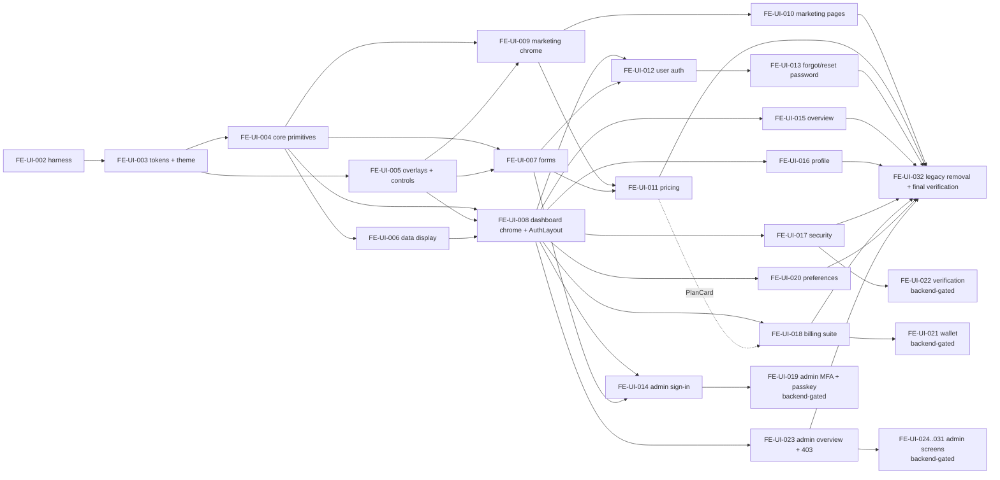

# Migration roadmap

How to move from today's TailAdmin/Solid-derived presentation layer to the [target UI architecture](./target-ui-architecture.md) without breaking live journeys. Each ticket below is sized for one Trello card (FE-UI-002 … FE-UI-032) and lists scope, affected workspaces, prerequisites, deliverables, functionality at risk, verification and completion criteria. Screen-level detail (reference files, states, operations, gaps) is in [`screen-inventory.json`](./screen-inventory.json); look up a ticket's screens with `roadmapTicket`.

## 1. Transition strategy

1. **Guardrails before change.** Journey tests and the workbench land first (FE-UI-002), so every later ticket proves it did not break sign-in, session refresh, profile, security or billing.
2. **Tokens with compatibility aliases.** FE-UI-003 introduces `@template/ui-core/theme.css` with temporary aliases for the old `brand-*` and `gray-*` utilities, so un-migrated screens keep rendering while migrated screens use semantic tokens. FE-UI-032 removes the aliases.
3. **Primitives behind stable seams.** New primitives are added next to old ones. Where an old component has many users and an accessibility defect (`Modal`), it is re-implemented on the new primitive behind its existing props first, so every flow benefits before any page is touched.
4. **Strangle per screen.** Each screen ticket swaps a page's view layer to the new primitives in one change. The container logic (hooks, `src/lib/*`, BFF routes) is moved, not rewritten. Deprecated components are deleted when their last consumer migrates.
5. **Capability-gated screens.** Screens that need backend work (class D) wait for their API. The frontend prepares shells, navigation groups and primitives so that each later screen is pure composition.
6. **Docs move with code.** Each ticket updates its screen records (`implementation.status`, `uiGaps`), the discrepancy register and, where architecture changes, OKF and `docs/architecture/`.

> **Numbering ([DR-077](./discrepancy-register.md#dr-077)).** Trello cards are authoritative; roadmap IDs below are unchanged until the backlog is reconciled. Trello **FE-UI-002** delivered roadmap **FE-UI-003** (tokens, theme, typography — [foundations.md](./foundations.md)). Trello **FE-UI-003** (shared UI primitives) delivered most of roadmap **FE-UI-004, 005 and 006**, the presentational controls of **FE-UI-007**, and the local part of **FE-UI-002** (workbench, browser-mode interaction tests, primitive visual regression) — see [shared-components.md](./shared-components.md). Each ticket below has a status line listing what remains.

## 2. Dependency graph

Parallel streams after FE-UI-008/009: **public** (010, 011), **auth** (012 → 013, 014), **user portal** (015–018, 020) and **admin** (023). Backend-gated tickets start when their API exists.

## 3. Phase overview

| Phase                  | Tickets                         | Outcome                                                                             |
| ---------------------- | ------------------------------- | ----------------------------------------------------------------------------------- |
| 0 Guardrails           | FE-UI-002                       | Journey, visual, a11y and component test harness; workbench; fixture isolation rule |
| 1 Foundations          | FE-UI-003 … 007                 | Tokens, theme, fonts; all shared primitives and form fields                         |
| 2 Shells               | FE-UI-008, 009                  | New dashboard and marketing chrome in all three apps                                |
| 3 Public               | FE-UI-010, 011                  | Marketing site matches the reference                                                |
| 4 Authentication       | FE-UI-012, 013, 014 (019 gated) | Auth screens redesigned; password recovery shipped                                  |
| 5 Existing user portal | FE-UI-015 … 018                 | Live user screens redesigned                                                        |
| 6 Missing user portal  | FE-UI-020 (021, 022 gated)      | Preferences; wallet and KYC when unblocked                                          |
| 7 Existing admin       | FE-UI-023                       | Admin overview, grouped navigation, forbidden state                                 |
| 8 Missing admin        | FE-UI-024 … 031 (all gated)     | Admin operations and analytics as APIs arrive                                       |
| 9 Completion           | FE-UI-032                       | Legacy code removed; full visual and accessibility pass                             |

## 4. Tickets

### FE-UI-002 — Verification harness and UI workbench

- **Status:** partly delivered by Trello FE-UI-003: `tooling/ui-workbench` (Storybook), Vitest browser mode in `ui-core`/`forms`, and primitive visual baselines (Windows/Chromium). Outstanding: CI jobs (OD-05), Playwright journeys with MSW, `@axe-core/playwright`, app-page screenshots, Linux baselines, fixture-isolation lint.

- **Scope:** add `tooling/ui-workbench` (Storybook, React + Vite, a11y addon, theme and viewport toolbar), Vitest browser mode for UI packages, Playwright project(s) with MSW-mocked backend, `@axe-core/playwright`, a fixture-isolation ESLint rule, and CI wiring through the devops-toolkit callers.
- **Affects:** root `pnpm-workspace.yaml` (`tooling/*`), `package.json` scripts, `turbo.json`, `packages/eslint-config`, `.github/workflows/*` (callers only), new `tooling/ui-workbench`, `e2e/` (or per-app `tests/e2e`).
- **Prerequisites:** OD-05.
- **Deliverables:** journey specs for user sign-in (password, 2FA, passkey cancel, Google outcome stubs), session refresh on expired token, logout, registration + confirmation, profile edit, security (sessions revoke, 2FA setup), billing (discovery/pending/subscription views, checkout submit + return outcomes); admin sign-in admission/rejection; public pricing. Visual baselines are **not** captured for the current UI (it is being replaced); visual tests start with each new component/screen.
- **At risk:** none (additive); CI duration.
- **Verification:** repository sequence; new `pnpm test:e2e`, `pnpm test:visual`, `pnpm workbench:build` green in CI.
- **Done when:** journeys pass against the current UI; a fixture import from production code fails lint; the workbench builds; OKF `testing-strategy` and `verification` concepts updated.

### FE-UI-003 — Tokens, theme and typography

- **Status:** delivered by Trello card FE-UI-002 (2026-11-25). The Foundations specimen is a development-only route in the public portal rather than a workbench story (OD-05 open); the harness prerequisite was not available, so verification used unit tests and manual browser checks ([foundations.md §10](./foundations.md#10-preview-and-verification)).

- **Screens:** `FND-FOUNDATIONS`.
- **Scope:** `packages/ui-core/src/styles/theme.css` (palette + semantic tokens, `@theme inline`, dark variant, radius/shadow/size/z tokens, breakpoints), compatibility aliases, `ThemeProvider`/`ThemeSwitch`/`ThemeSelect` (`next-themes`), Outfit + JetBrains Mono via `next/font` in all three root layouts, the `--brand-primary` decision (DR-005), and a Foundations story page.
- **Affects:** `ui-core` (new export `./theme.css`), `dashboard-ui` (theme file becomes an alias import), all three `globals.css` and root layouts, public portal font swap.
- **Prerequisites:** FE-UI-002; OD-04, OD-08.
- **At risk:** global visual shift (dark mode becomes neutral; public portal font); theme persistence (keep the `theme` storage key).
- **Verification:** workbench foundations snapshots (light/dark); journeys green; manual dark/light/system check in all apps; no flash of the light theme.
- **Done when:** all apps load `@template/ui-core/theme.css`; no component reads Solid tokens except un-migrated public sections; OKF `ui-composition` updated (token source, fonts, theme engine).

### FE-UI-004 — Core primitives and icons

- **Status:** delivered by Trello FE-UI-003 except `CopyButton`, `PlanCard`, `Steps`, `Timeline`, the date formatter (built with their first screens) and the hex/palette lint rule.

- **Scope:** `cn`/`cva`, `Button`/`IconButton`, `Badge`, `Chip`, `Avatar`, `IconTile`, `Card` (extended), `Panel`, `Alert` (extended), `KeyValueList`, `ListRow`, `Stat`/`StatGrid`, `Progress`, `Spinner`, `Divider`, `EmptyState`/`ErrorState`, `CopyButton`, `PlanCard`, date formatter, Lucide icon module; lint rule against hex values and raw palette classes (warning level until FE-UI-032).
- **Affects:** `ui-core`; `buttonClassName` kept as a deprecated wrapper over `buttonVariants`.
- **Prerequisites:** FE-UI-003.
- **At risk:** low (additive).
- **Verification:** stories for every variant × theme; interaction/a11y tests; visual baselines for primitives.
- **Done when:** primitives exported, documented in the workbench, tested; `component-inventory.md` statuses updated.

### FE-UI-005 — Overlays and interactive controls (Radix)

- **Status:** delivered by Trello FE-UI-003: `Dialog` (phone bottom sheet), `ConfirmDialog`, `Modal` on `Dialog`, Radix `Tabs` (controlled), `SegmentedControl`, `Switch`, native `Checkbox`/`RadioGroup`/`RadioCard`. Deferred: `Drawer`, `Sheet`, `DropdownMenu`, `Popover`, `Tooltip`, the tabs link variant.

- **Scope:** `Dialog`, `ResponsiveDialog`, `ConfirmDialog`, `Drawer`, `Sheet`, `DropdownMenu`, `Popover`, `Tooltip`, `Tabs` (controlled + link variant), `SegmentedControl`, `Switch`, `Checkbox`, `RadioGroup`/`RadioCard`. Re-implement the existing `Modal` on `Dialog` behind its current props.
- **Affects:** `ui-core`; every existing modal benefits automatically.
- **Prerequisites:** FE-UI-003.
- **At risk:** existing modals (cancel at period end, password change, 2FA proof, passkey rename/remove, passkey added): focus and close behaviour changes.
- **Verification:** keyboard/focus tests in browser mode; axe; journeys that open modals.
- **Done when:** no consumer uses a focus-trap-less dialog; `Tabs` supports `?tab=`.

### FE-UI-006 — Data display

- **Status:** delivered by Trello FE-UI-003: `DataTable` (alignment, `mobileLabel`, opt-in stacked phone mode, loading/empty/error), `Pager`, `SearchInput`, chart foundations. Deferred: `Timeline`, `Steps`, date-range popover. Existing tables keep scrolling on phones until OD-02.

- **Scope:** `DataTable` (alignment, `mobileLabel`, stacked phone mode, loading/empty/error rows), `Pager`, `Timeline`, `Steps`, `SearchInput`, date-range `Popover` with native inputs (TD-19).
- **Affects:** `ui-core`; `Pagination` deprecated.
- **Prerequisites:** FE-UI-004.
- **At risk:** billing history, security activity and sessions tables (consumers are migrated in their screen tickets).
- **Verification:** stories at 390/768/1440; screen-reader table semantics checked.
- **Done when:** components exported and tested.

### FE-UI-007 — Form fields

- **Status:** Trello FE-UI-003 rebuilt `TextField`, `PasswordField`, `ConfirmationCodeField` (on `OtpInput`), `SearchableSelectField` and `SubmitButton` on the new controls with unchanged RHF behaviour. The new connected fields and `PasswordStrength` remain.

- **Scope:** rebuild `TextField`, `PasswordField`, `SearchableSelectField`, `OtpField` (from `ConfirmationCodeField`), `SubmitButton`; add `SelectField`, `TextareaField`, `CheckboxField`, `SwitchField`, `RadioCardGroupField`, `SegmentedField`, `PasswordStrength`.
- **Affects:** `forms`; consumers in user/admin portals compile unchanged where the API is kept.
- **Prerequisites:** FE-UI-004, FE-UI-005.
- **At risk:** every form (validation display, backend error mapping, OTP paste/autofill).
- **Verification:** existing `forms` tests unchanged and green; new interaction tests (paste, autofill, error announcement); auth/profile journeys.
- **Done when:** fields match the reference in both themes; `applyBackendValidation` behaviour unchanged.

### FE-UI-008 — Dashboard chrome and auth layout

- **Screens:** `USR-NAV-MOBILE`, `ADM-NAV-MOBILE` (and the shell of every dashboard screen).
- **Scope:** `AppShell`, grouped `Sidebar`, `MobileTopBar`, `MobileTabBar`, `MobileNavDrawer`, `UserIdentity`, `PageHeader`, `FilterBar`, `AuthLayout`, `BrandMark`; migrate `user-layout-shell.tsx` and `admin-layout-shell.tsx`; identity from profile/session; fix DR-027; hide admin items without routes (DR-071); add grouped admin navigation model; remove the collapsible rail (OD-07); add dashboard `not-found.tsx`.
- **Affects:** `dashboard-ui`, `apps/user-portal/src/components`, `apps/admin-portal/src/components`, both `config/navigation.ts`.
- **Prerequisites:** FE-UI-004/005/006; OD-07, OD-13.
- **At risk:** navigation active states (`isNavItemActive` tests), logout button, `PasskeyAddedModal` mount point, layout bypass for auth routes (`src/lib/user-layout.ts`).
- **Verification:** navigation tests; journeys; visual baselines of the shell at 390/1024/1440 × light/dark.
- **Done when:** both dashboards render the new chrome; no hardcoded identity; no 404 navigation links.

### FE-UI-009 — Marketing chrome and section library

- **Screens:** `MKT-NAV-MOBILE` (and the shell of every marketing page).
- **Scope:** new `public-ui` (`MarketingHeader` + `Sheet`, `MarketingFooter`, `Hero`, `ProductShot`, `SectionHeading`, `FeatureCardGrid`, `NumberedFeatureList`, `CtaBanner`, `FaqList`, `BlogCardGrid`, `ContactLayout`, `LegalDocument`); remove `framer-motion`, `PublicUiProvider`, Solid tokens and unused `/images/*`.
- **Affects:** `public-ui`, `apps/public-portal` (`layout.tsx`, `globals.css`, `config/site.ts` shapes).
- **Prerequisites:** FE-UI-004/005.
- **At risk:** SEO metadata, sitemap, User Portal CTA links (`userPortalHref`).
- **Verification:** public build; Lighthouse/axe on home; visual baselines.
- **Done when:** the public layout uses new chrome; mojibake gone (DR-021).

### FE-UI-010 — Marketing pages

- **Screens:** `MKT-HOME`, `MKT-FEATURES`, `MKT-ABOUT`, `MKT-BLOG`, `MKT-CONTACT`, `MKT-LEGAL`.
- **Prerequisites:** FE-UI-009; OD-01, OD-10, OD-12.
- **At risk:** home pricing teaser (if kept, still backend plans only); legal routes.
- **Done when:** pages match the reference; the contact page never shows a fake success; sitemap updated if routes change.

### FE-UI-011 — Pricing

- **Screens:** `MKT-PRICING`.
- **Scope:** `PlanCard` grid with Monthly/Yearly `SegmentedControl`, plans still loaded in Server Components, FAQ, empty/unavailable states.
- **Prerequisites:** FE-UI-009, FE-UI-007; OD-03.
- **At risk:** checkout deep links (`planId`, `billingInterval`), caching (`revalidate 60`, tag).
- **Verification:** `subscription-pricing` tests; journey public pricing → sign-in → checkout.
- **Done when:** both intervals selectable; no local tier labels.

### FE-UI-012 — User authentication screens

- **Screens:** `AUTH-SIGN-IN`, `AUTH-REGISTER`, `AUTH-CONFIRM-EMAIL`, `AUTH-TWO-FACTOR`, `AUTH-PASSKEY-SETUP`, `AUTH-GOOGLE-LINK`, `AUTH-GOOGLE-REGISTER`, `AUTH-MESSAGES`.
- **Scope:** recompose on `AuthLayout`, `forms`, `Alert`, `Steps`; keep the GIS button (DR-013); omit "Keep me signed in" (OD-16); add the "Forgot password?" link only together with FE-UI-013.
- **Prerequisites:** FE-UI-008, FE-UI-007; decision on DR-014.
- **At risk (highest):** password/Google/passkey sign-in, 2FA continuation cookies, unconfirmed-email redirect, `returnTo` sanitising, resend cooldown, passkey setup skip/continue.
- **Verification:** all auth journeys; existing tests (`passkey-sign-in-button`, `google-authentication-button`, `passkey-setup-prompt`, lib tests) unchanged and green; axe on each screen.
- **Done when:** visual parity with the reference in four variants; no change to `src/lib/*` or BFF routes.

### FE-UI-013 — Forgot and reset password

- **Screens:** `AUTH-FORGOT-PASSWORD`, `AUTH-RESET-PASSWORD`.
- **Scope:** `/forgot-password` and `/reset-password` pages; `PUBLIC_PATHS` additions; api-react hooks for the existing mutation options; "Forgot password?" link on sign-in.
- **Prerequisites:** FE-UI-012; DR-015 (reset-link format, error codes).
- **At risk:** proxy guard (only explicit additions), account-enumeration leaks.
- **Verification:** route/proxy tests; journey request → reset → sign in with mocked backend.
- **Done when:** both flows work end-to-end against the backend; "sent" state is identical for known and unknown emails.

### FE-UI-014 — Admin sign-in

- **Screens:** `ADM-SIGN-IN`.
- **Scope:** `AuthLayout` with the admin panel; password flow unchanged; omit passkey until FE-UI-019.
- **Prerequisites:** FE-UI-008, FE-UI-007.
- **At risk:** role admission, rejection cleanup, refresh role re-check.
- **Done when:** admin admission tests green; visual parity.

### FE-UI-019 — Admin MFA and passkey sign-in (backend-gated)

- **Scope:** admin BFF for 2FA completion and passkeys, reusing existing api-client operations; admin two-factor page.
- **Prerequisites:** OD-14 (role claim, MFA policy).

### FE-UI-015 — Overview dashboard

- **Screens:** `USR-DASHBOARD`.
- **Scope:** greeting header, stat tiles backed by real data (plan, sessions, security score from 2FA/passkeys), profile card, security checklist, recent billing activity; omit unsupported tiles (DR-018, DR-050).
- **Prerequisites:** FE-UI-008.
- **At risk:** Server Component data loading, `loading.tsx`/`error.tsx`.
- **Done when:** no placeholder metrics; nothing rendered without a backend source.

### FE-UI-016 — Profile

- **Screens:** `USR-PROFILE`.
- **Prerequisites:** FE-UI-008, FE-UI-007.
- **At risk:** avatar direct-upload sequence, name update and validation mapping.
- **Done when:** parity for supported fields; unsupported fields recorded (DR-019).

### FE-UI-017 — Security

- **Screens:** `USR-SECURITY`, `USR-TWO-FACTOR-SETUP`.
- **Scope:** six URL-addressable tabs; overview score from real facts; password, passkeys, two-factor, sessions, activity on new primitives; three-step 2FA dialog with saved-codes confirmation.
- **Prerequisites:** FE-UI-008, FE-UI-005/006/007; OD-09.
- **At risk:** passkey registration ceremony, 2FA setup/verify/regenerate/disable proofs, revoke session/others, activity pagination.
- **Verification:** existing security tests and journeys; deep-link `?tab=` tests.
- **Done when:** all six tabs live with only backend data.

### FE-UI-018 — Billing suite

- **Screens:** `USR-BILLING`, `USR-CHECKOUT`, `USR-CHECKOUT-RESULT`, `USR-BILLING-HISTORY`, `USR-PURCHASE-DETAIL`. May split into 018a (billing + history + purchase) and 018b (checkout + results).
- **Scope:** restyle every view selected by `billing-view.ts` and `payment-return.ts`; `PlanCard` reuse; provider `RadioCard`s; result template for all outcomes; history per OD-02.
- **Prerequisites:** FE-UI-008, FE-UI-006/007, FE-UI-011 (`PlanCard`); OD-02.
- **At risk:** idempotency/attempt storage, payment-link safety, polling, cancel at period end, history pagination.
- **Verification:** existing billing tests unchanged; checkout/return journeys; visual baselines for each billing state (active, cancelling, past due, pending, discovery).
- **Done when:** parity for supported states; unsupported actions absent (DR-055–058).

### FE-UI-020 — Preferences

- **Screens:** `USR-PREFERENCES`. Theme selection only (OD/DR-051); navigation item added.

### FE-UI-021 — Wallet (backend-gated)

- **Screens:** `USR-WALLET`, `USR-WALLET-TOP-UP`. Needs a balance read model, list fields and per-intent return URLs (DR-059).

### FE-UI-022 — Identity verification (backend-gated)

- **Screens:** `USR-VERIFICATION`. Needs a KYC API (DR-054).

### FE-UI-023 — Admin overview, navigation groups and forbidden state

- **Screens:** `ADM-DASHBOARD`, `ADM-FORBIDDEN`.
- **Scope:** restyled overview placeholder (no mock numbers); in-shell 403 state for backend `403` responses; grouped navigation ready for later items.
- **Prerequisites:** FE-UI-008.
- **At risk:** admin proxy admission (unchanged).

### FE-UI-024 … FE-UI-031 — Admin operations and analytics (backend-gated)

| Ticket    | Screens                                                                                        | Needs                                         |
| --------- | ---------------------------------------------------------------------------------------------- | --------------------------------------------- |
| FE-UI-024 | `ADM-USERS`, `ADM-USER-DETAIL`, `ADM-STEP-UP`                                                  | admin user APIs, step-up (DR-072)             |
| FE-UI-025 | `ADM-ROLES`, `ADM-ROLE-EDIT`                                                                   | permission model (DR-073)                     |
| FE-UI-026 | `ADM-SUBSCRIPTIONS`, `ADM-SUBSCRIPTION-DETAIL`, `ADM-ALLOCATE`, `ADM-PLANS`                    | admin subscription and plan APIs (DR-070)     |
| FE-UI-027 | `ADM-PAYMENTS`, `ADM-PAYMENT-DETAIL`                                                           | admin payment APIs                            |
| FE-UI-028 | `ADM-KYC`, `ADM-KYC-DETAIL`                                                                    | KYC API (DR-054)                              |
| FE-UI-029 | `ADM-PROVIDERS`, `ADM-REFERENCE-DATA`                                                          | provider reads (DR-074); languages/currencies |
| FE-UI-030 | `ADM-AUDIT`, `ADM-SYSTEM-HEALTH`                                                               | audit and health APIs                         |
| FE-UI-031 | `ADM-REGISTRATIONS`, `ADM-ACTIVE-USERS`, `ADM-PAYMENT-ANALYTICS`, `ADM-SUBSCRIPTION-ANALYTICS` | analytics APIs; introduces Recharts (TD-10)   |

Each adds api-client contracts/operations and api-react hooks for the new endpoints (handwritten, per AGENTS.md), routes under the admin proxy, a navigation item, and screens composed from existing primitives.

### FE-UI-032 — Legacy removal and final verification

- **Scope:** delete compatibility aliases, `tailadmin-theme.css`, deprecated components (`buttonClassName`, `Modal`, `Pagination`, `StatusBadge`, `SectionHeader`, `ThemeToggle`, Solid sections), unused dependencies; licence notices per OD-06; lint rule to error level; full visual and accessibility pass across every implemented screen; update OKF and `docs/architecture/03`, `04`.
- **Done when:** no TailAdmin/Solid-derived code remains, or remaining files are listed with their notices kept; all verification suites green.

## 5. Recommended order (deviations from the ticket's suggested sequence)

The ticket suggested public → auth → user → admin after primitives. This roadmap runs public and authenticated streams **in parallel** after the shells and puts the verification harness **first**. The public site is low risk but also low dependency, while the auth and billing journeys carry the most live behaviour and benefit most from early, isolated changes. Admin screens beyond the overview are gated by backend capabilities, not by frontend order.
