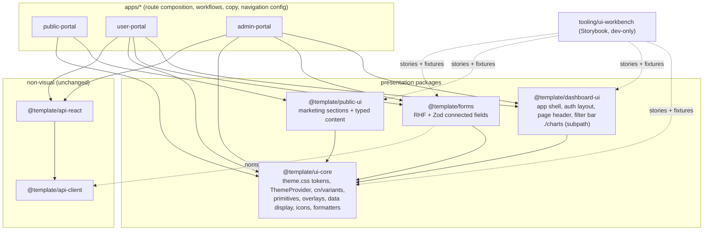

# Target UI architecture

This is the presentation architecture we would build if the three portals were started today against the pinned design system (`d23eb85`). It was defined **before** grading the existing TailAdmin/Solid-derived code; [existing-ui-assessment.md](./existing-ui-assessment.md) then measures the current code against it, and [technology-decisions.md](./technology-decisions.md) records the alternatives behind each choice.

Non-visual architecture is not in question and is preserved as-is: the handwritten `@template/api-client`, `@template/api-react` (TanStack Query), BFF Route Handlers and cookie sessions, `proxy.ts` guards, React Hook Form + Zod workflows, server/browser boundaries, three independently deployable apps, and thin CI/CD callers.

## 1. What the design system requires

Derived from the canonical files' inlined `theme.css` and the 307 screens:

| Requirement                                             | Evidence in the reference                                                                                                                                                                                                              |
| ------------------------------------------------------- | -------------------------------------------------------------------------------------------------------------------------------------------------------------------------------------------------------------------------------------- |
| One visual language for marketing, auth, user and admin | All 307 files share one stylesheet scoped to `.tp`; marketing uses the same tokens and components as the dashboards.                                                                                                                   |
| Semantic, theme-swapped tokens                          | `.tp` / `.tp.dark` redefine ~45 custom properties (`--bg`, `--surface`, `--text-2`, `--brand-ink`, `--success-bg`, `--chart-1`, `--nav-active-bg`, ...); component rules never mention a theme.                                        |
| Light = blue/white, dark = neutral grey                 | Dark keeps blue only for primary buttons, links and focus (`Main.html` lead text); dark tabs and nav go neutral.                                                                                                                       |
| Light, dark **and system** theme                        | `USR-PREFERENCES` offers Light / Dark / Match system; every top bar has a theme switch.                                                                                                                                                |
| Outfit + JetBrains Mono                                 | Font links in every file; mono for references, codes, keys.                                                                                                                                                                            |
| 44 px minimum targets                                   | `.btn`, `.input`, `.nav a`, `.tabs button`, `.icon-btn` all set `min-height:44px`.                                                                                                                                                     |
| Two layouts per screen, one structure                   | Desktop 1440 artboards, mobile 390 artboards; `.m` phone layout "also kicks in under 700px". Mobile differs by chrome (top bar, tab bar, drawer, sheets) and by table→card stacking, not by content.                                   |
| Accessible overlays                                     | Modal (`role=dialog`, ≤520 px, bottom sheet on phones), right drawer (≤520 px, full width on phones), left nav drawer (304 px), full-screen menu sheet.                                                                                |
| Rich but conventional controls                          | Segmented control, switch, OTP boxes, radio cards, checkboxes with descriptions, search input, filter buttons ("Status: Any"), tabs, steps, progress, timeline, key-value lists, badges with dots, chips, avatars, stat tiles, alerts. |
| Server-paginated data tables                            | Uppercase header row on `surface-2`, Prev/Next pager with "Showing 1–6 of 4,912"; phones stack each row as a labelled card (`data-label`).                                                                                             |
| Charts                                                  | Line/area, grouped and stacked bars, donut, horizontal bars; four chart tokens + grid token; 240 px desktop / 180 px phone height.                                                                                                     |
| No motion language                                      | The reference defines no animation beyond hover colour changes.                                                                                                                                                                        |

## 2. Architecture at a glance

The dependency direction is today's: apps → feature-neutral packages → `ui-core`. Nothing in `packages/*` imports an app, a route, navigation config or a business workflow.

## 3. Design tokens

- **Single source:** `packages/ui-core/src/styles/theme.css`, exported as `@template/ui-core/theme.css` and imported by all three apps' `globals.css`. It replaces `packages/dashboard-ui/src/tailadmin-theme.css` and the Solid `@theme` in `apps/public-portal/src/app/globals.css`.
- **Two tiers in CSS custom properties:**
  1. _Palette_ (raw values, never used by components): `--palette-blue-50…950` (today's `brand-*` scale is already this blue), `--palette-slate-*` (light neutrals), `--palette-zinc-*` (dark neutrals), status hues.
  2. _Semantic_ (what components use), defined on `:root` and redefined on `.dark`: `--color-bg`, `--color-surface`, `--color-surface-2/3`, `--color-hover`, `--color-border`, `--color-border-strong`, `--color-fg`, `--color-fg-muted`, `--color-fg-subtle`, `--color-brand`, `--color-brand-hover/press/soft/soft-2/ink`, `--color-on-brand`, `--color-nav-bg/nav-active-bg/nav-active-fg`, `--color-{success,warning,danger,info}` + `-bg`, `--color-neutral-bg`, `--color-chart-1…4`, `--color-grid`, `--color-scrim`, plus radius, shadow, size and z-index tokens.
- **Tailwind binding:** `@theme inline { --color-surface: var(--color-surface); … }` so utilities read `bg-surface text-fg-muted border-border ring-brand-soft-2`. Because the variables swap under `.dark`, components need almost no `dark:` variants; `dark:` remains available through `@custom-variant dark (&:where(.dark, .dark *))` for the few true exceptions (for example the dark auth art panel).
- **Rebranding** a template instance means replacing the blue palette and, optionally, the neutral palettes — never editing components. The runtime `NEXT_PUBLIC_BRAND_PRIMARY_COLOUR` hook (today ignored by the dashboards) is either wired into the palette or removed ([DR-005](./discrepancy-register.md#dr-005)).

Full value tables and the old→new mapping: [token-mapping.md](./token-mapping.md).

## 4. Styling infrastructure

- Tailwind CSS v4 (already in use, PostCSS plugin, no config file) remains the styling engine; it consumes the token file through `@theme`.
- Component variants are declared with `class-variance-authority` and merged with `tailwind-merge` through one `cn()` helper in `ui-core`, so consumers can override safely (`<Button className="w-full">`).
- No component CSS files, no CSS-in-JS, no hex values in components (lint-enforced; see [integration-strategy.md](./integration-strategy.md)).
- App `globals.css` keeps resets inside `@layer base` (existing OKF rule) and `@source`s the packages it compiles.

## 5. Component primitives

- **Behaviour** from Radix UI primitives (Dialog, DropdownMenu, Popover, Tooltip, Tabs, ToggleGroup, Switch, Checkbox, RadioGroup, Slot), **appearance** from our tokens. Components are owned source in `ui-core` (the "open code" model popularised by shadcn/ui, without its CLI), so the design can evolve without forking a vendor library.
- Interactive components are client components (`"use client"` per file); static primitives (`Card`, `Badge`, `KeyValueList`, `Stat`, `DataTable` markup) stay server-compatible so Server Components such as `/dashboard` and public pages keep rendering on the server.
- Every primitive exposes `className` and, where it renders an interactive element, `asChild` (Radix `Slot`) so links can look like buttons without nesting.

Catalogue and per-pattern ownership: [component-inventory.md](./component-inventory.md).

## 6. Iconography and typography

- **Icons:** `lucide-react`. The reference glyphs are 24 px, `stroke-width 1.8`, round caps/joins — Lucide's geometry. `ui-core` re-exports the curated subset behind a thin `Icon` sizing wrapper (16/18/20/22 px from the reference) so apps do not pick arbitrary sizes. Brand marks (Google "G", provider logos) stay app-local SVGs.
- **Typography:** Outfit (400/500/600/700) and JetBrains Mono (400/500) loaded with `next/font/google` in each app root layout, exposed as CSS variables consumed by `theme.css`. Type scale tokens: display 56, h1 28, h2 20, h3 16, body 15, small 13, caption 12, plus marketing 36/19 and phone overrides (h1 24, h2 18, display 34–38).

## 7. Theme management

- `next-themes` (already used by the public portal) in all three apps through a `ThemeProvider` exported by `ui-core`: `attribute="class"`, `enableSystem`, `defaultTheme="system"`, `disableTransitionOnChange`, `suppressHydrationWarning` on `<html>`. Its blocking script removes today's flash of the light theme in the dashboards.
- One `ThemeSwitch` (top bars, drawers) and one `ThemeSelect` (Preferences: Light / Dark / Match system) in `ui-core`.
- Preference is per origin (each portal is its own deployment); cross-portal sync is out of scope until a backend preference exists ([DR-051](./discrepancy-register.md#dr-051)).

## 8. Responsive layout

- Breakpoints (Tailwind defaults, replacing the TailAdmin set): `sm` 640, `md` 768, `lg` 1024, `xl` 1280, `2xl` 1536.
- **Phone layout below `md`** (the reference's `.m` threshold is 700 px; 768 is the nearest standard step and also covers small tablets in portrait). **Persistent sidebar from `lg`**; between `md` and `lg` the dashboards use the mobile top bar + drawer with desktop content density.
- Grids follow the reference's intrinsic pattern (`repeat(auto-fit, minmax(min(100%, Npx), 1fr))`), so cards reflow without breakpoint-specific code; the phone layout forces 2-column stat grids and single-column card grids.
- Page container: max 1280 px, 32 px padding desktop, 20/16 px phone (tokens).
- Differences that are more than CSS are handled by explicit components, not duplicated pages: `MobileTabBar`, `MobileNavDrawer`, `ResponsiveDialog` (centred modal ↔ bottom sheet), `DataTable` stacked mode. See [integration-strategy.md](./integration-strategy.md#3-responsive-rules).

## 9. Dashboard composition (`@template/dashboard-ui`)

- `AppShell`: 260 px sidebar (logo, optional portal chip, grouped nav with section labels, footer slot for help/identity/sign-out), 68 px top bar (breadcrumbs, optional search slot, theme switch, identity), content container. Below `lg`: `MobileTopBar` (menu button, logo, actions) + `MobileNavDrawer` (identity, nav, theme switch, sign-out) + optional `MobileTabBar` (user portal: up to 5 items).
- `PageHeader` (title, description, actions, back link), `FilterBar` (search + filter-menu buttons + date-range trigger), `AuthLayout` (form column + brand panel, panel hidden on phones).
- Apps pass navigation items, groups, identity (from the real profile/session), and actions. Authorization-aware filtering of navigation stays in the app.
- The collapsible 72 px icon rail of today's sidebar has no counterpart in the reference and is dropped ([DR-025](./discrepancy-register.md#dr-025)).

## 10. Marketing composition (`@template/public-ui`)

- `MarketingHeader` (with mobile `Sheet` menu and theme switch), `MarketingFooter` (three link columns), `Hero`, `SectionHeading`, `FeatureCardGrid`, `NumberedFeatureList`, `ProductShot` (decorative composition slot), `CtaBanner`, `FaqList`, `BlogCardGrid`, `ContactLayout`, `LegalDocument` (TOC + document switch as links).
- Typed content inputs stay in the package; concrete copy, URLs, metadata, SEO and page assembly stay in `apps/public-portal`. Plans are still loaded by the app in Server Components and passed to the shared `PlanCard`.
- No `framer-motion`, no decorative image assets, no Solid tokens.

## 11. Data display

- `DataTable` (ui-core): column definitions (`header`, `cell`, `align`, `mobileLabel`, `mobilePrimary`), semantic `<table>`, header on `surface-2`, row actions, loading skeleton rows, empty and error states, horizontal scroll container on desktop, stacked label/value cards on phones. Sorting and filtering are server-driven by the app through URL search params; no client-side data-grid engine is needed for the designed screens.
- `Pager` (ui-core): "Showing a–b of n" + Previous/Next, link- or callback-driven, works with page and cursor APIs. Replaces numbered pagination.
- `KeyValueList`, `Timeline`, `Steps`, `Progress`, `Stat`/`StatGrid`, `ListRow`, `EmptyState`, `ErrorState`.

## 12. Data visualisation

- Recharts behind thin wrappers in `@template/dashboard-ui/charts` (`LineChart`, `AreaChart`, `BarChart` grouped/stacked, `DonutChart`, `HBarList`, `ChartLegend`), colours from `--color-chart-*` and `--color-grid`, axis text 11 px `fg-subtle`, every chart paired with an accessible data table or summary.
- Introduced only with the first admin analytics ticket; no other screen needs charts.

## 13. Overlays

All on Radix Dialog / DropdownMenu / Popover / Tooltip, rendered in a portal with focus trapping, `Esc`, outside-click and focus return:

| Component                | Desktop                                  | Phone                   |
| ------------------------ | ---------------------------------------- | ----------------------- |
| `Dialog`                 | centred, max 520 px, radius 18, `scrim`  | bottom sheet, radius 20 |
| `Drawer`                 | right, `min(520px, 100%)`                | full width              |
| `MobileNavDrawer`        | —                                        | left, 304 px / 86%      |
| `Sheet` (marketing menu) | —                                        | full screen             |
| `DropdownMenu`           | filter menus, identity menu, row actions | same, 44 px items       |
| `Popover`                | date range, column help                  | same                    |

## 14. Forms (`@template/forms`)

React Hook Form + Zod (`useValidatedForm`, `ValidatedForm`, `applyBackendValidation`) stay. Connected fields are rebuilt on `ui-core` controls: `TextField`, `PasswordField` (+ optional `PasswordStrength` driven by app-supplied rules), `SelectField` (native), `SearchableSelectField` (combobox), `TextareaField`, `CheckboxField`, `SwitchField`, `RadioCardGroupField`, `SegmentedField`, `OtpField` (today's `ConfirmationCodeField`, 52×60 boxes, 46×54 on phones), `SubmitButton` (uses `Button`).

## 15. Previews, fixtures and testing

- `tooling/ui-workbench`: Storybook (React + Vite builder) hosting stories for all UI packages and app **view** components, with typed fixtures, light/dark and desktop/phone toolbar globals, and the a11y addon. Dev/CI only; never deployed.
- Component interaction and accessibility tests: Vitest browser mode (Playwright provider) for `ui-core`/`forms` primitives; existing `renderToStaticMarkup` tests for app view logic stay.
- Visual regression and journey tests: Playwright (`toHaveScreenshot`, `@axe-core/playwright`) against the workbench and against the apps with a mocked backend.

Details: [verification-strategy.md](./verification-strategy.md).

## 16. Package boundaries (target)

| Package                  | Owns                                                                                                                                                               | Must not own                                                                                |
| ------------------------ | ------------------------------------------------------------------------------------------------------------------------------------------------------------------ | ------------------------------------------------------------------------------------------- |
| `@template/ui-core`      | `theme.css`, `ThemeProvider`, `cn`, icons, formatters (`formatMinorUnits`, dates), all domain-free primitives, overlays, data display, `PlanCard` (presentational) | navigation, routes, API calls, business rules, copy beyond generic defaults (`aria` labels) |
| `@template/dashboard-ui` | `AppShell` family, `PageHeader`, `FilterBar`, `AuthLayout`, `./charts`                                                                                             | app navigation config, identity fetching, authorization                                     |
| `@template/public-ui`    | marketing sections and their typed content shapes                                                                                                                  | concrete copy, URLs, SEO, plan loading                                                      |
| `@template/forms`        | RHF/Zod integration, connected fields, backend validation mapping                                                                                                  | workflow schemas, messages, submission logic                                                |
| `apps/*`                 | routes, page composition, navigation config, workflows, BFFs, copy, fixtures for app views (workbench-only)                                                        | reusable primitives, tokens                                                                 |

No new UI package is introduced: the four existing packages already express the right ownership; what changes is their contents ([technology-decisions.md](./technology-decisions.md#td-14-package-organisation)).
